# 杨艳娜 · Yanna Yang

**软件工程硕士研究生 | 西北师范大学**  
M.Sc. Student in Software Engineering, Northwest Normal University

[研究方向](#研究方向) · [代表论文与效果展示](#代表论文与效果展示) · [项目展示](#项目展示) · [学术成果](#学术成果) · [教育与技能](#教育与技能)

[Email](mailto:18822044020@163.com) / [JianduReg Code](https://github.com/yannayang58-dev/JianduReg) / [数字简牍平台](https://jdsjk.nwnu.edu.cn/) / [个人网站](https://yannayang58-dev.github.io/)

## 个人简介

我目前在西北师范大学攻读软件工程硕士学位，研究三维视觉与文化遗产智能计算。主要工作围绕**三维点云配准、可靠对应关系筛选、简牍碎片检索及虚拟重建**展开，并探索**知识图谱与大语言模型智能体**在简牍文献组织、检索与问答中的应用。

My research focuses on 3D point cloud registration, correspondence selection, fracture retrieval, and virtual reassembly for cultural heritage. I also work on knowledge graph enhanced question answering and AI agents.

## 研究方向

| 方向 | 研究重点 |
| --- | --- |
| **三维点云配准 / 3D Registration** | 特征匹配、可靠对应筛选、刚性位姿估计与粗到精配准 |
| **碎片虚拟重建 / Virtual Reassembly** | 简牍断裂面建模、碎片检索、几何闭合与三维数据集构建 |
| **知识图谱与智能体 / Knowledge Graphs & Agents** | Qwen、Neo4j、Text-to-Cypher、RAG 与多跳问答 |

## 代表论文与效果展示

### JianduReg: 断裂面引导的简牍多阶段点云配准

**A Fracture Surface Guided Multistage Registration Framework for Bamboo Slip Point Clouds**  
Teng Wan, **Yanna Yang**, Fengchen Qi, Qiang Zhang, Ying Qi, Shaoyi Du  
*npj Heritage Science*, **Accepted, 2026** · 第二作者  
[Code & Reproducibility Examples](https://github.com/yannayang58-dev/JianduReg)

面向极薄简牍、狭窄断裂面、磨损和缺失等困难，结合断裂面几何先验、法向增强粗配准（NE-DCP）与双向最大相关熵精配准（BMCC-ICP），支持非接触式虚拟缀合。

<table>
<tr><td align="center"><b>真实简牍的虚拟缀合</b></td><td align="center"><b>方法总体框架</b></td></tr>
<tr>
<td width="50%">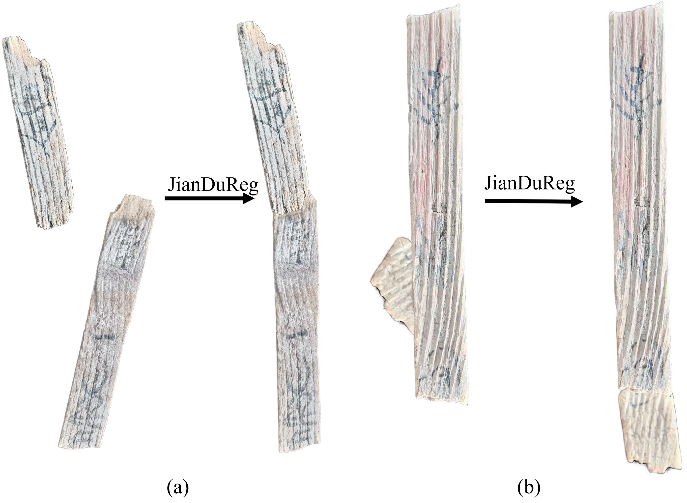</td>
<td width="50%">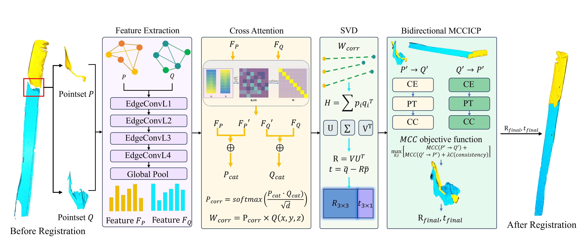</td>
</tr>
</table>

**效果说明。** 左图为论文 Fig. 10 中两个真实扫描样本的缀合前后对比；右图为 Fig. 2 方法框架。输入断裂面由半自动裁剪与专家修正获得。

<b>展开查看真实数据对比、消融实验及完整论文图组（Fig. 1–10）</b>

#### 真实扫描简牍的配准效果

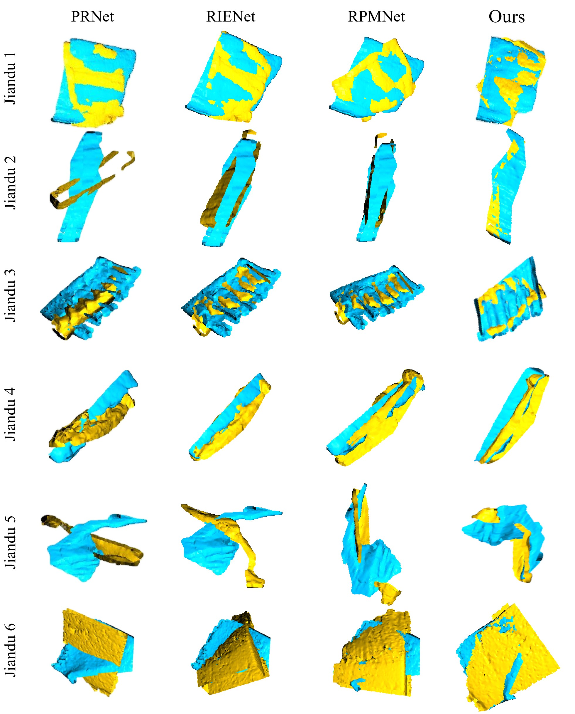

*Fig. 9：真实扫描断裂面上的学习方法对比；列标题与样本标注保持原图。青色和黄色为待配准的两部分。*

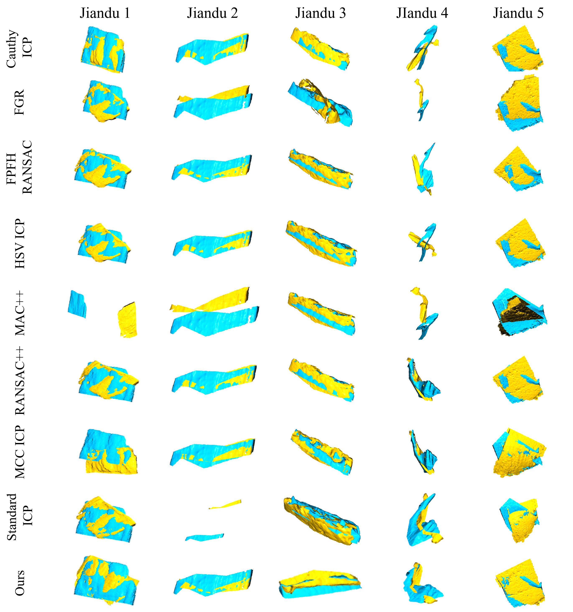

*Fig. 8：真实扫描简牍上与传统方法的定性比较。*

#### 模块消融与几何建模

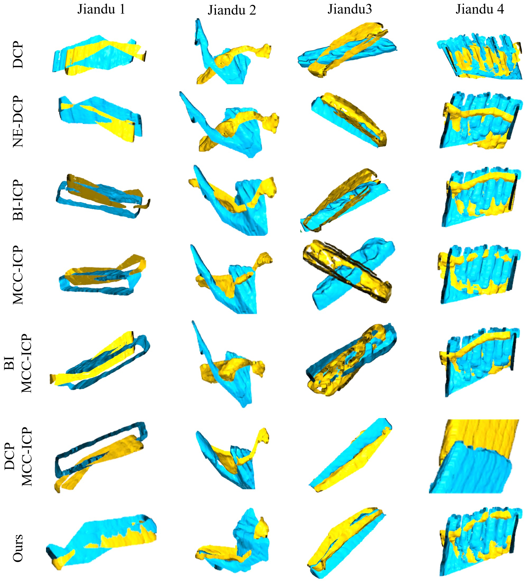

*Fig. 5：不同模块组合在真实扫描简牍上的可视化消融。*

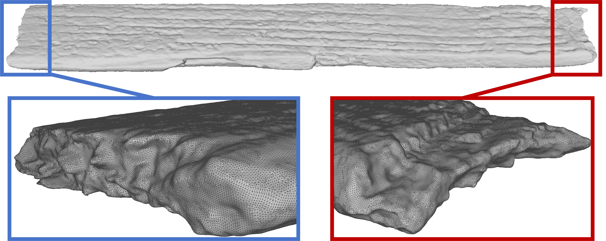

*Fig. 3：断裂面选取及局部几何细节。*

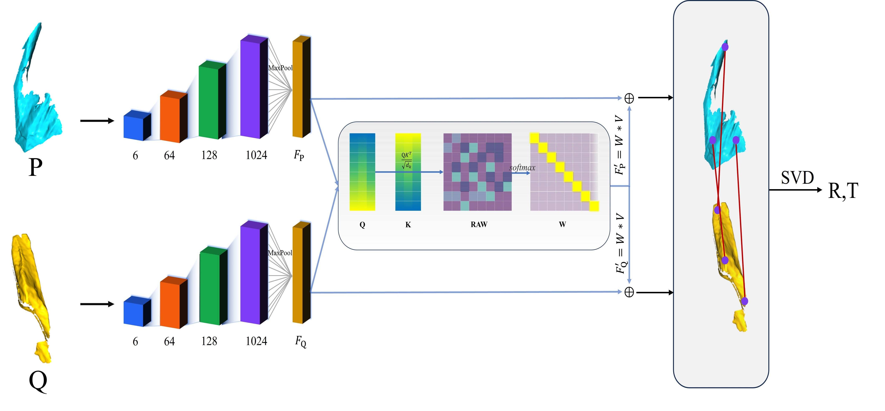

*Fig. 4：NE-DCP 粗配准网络。*

#### 合成简牍基准

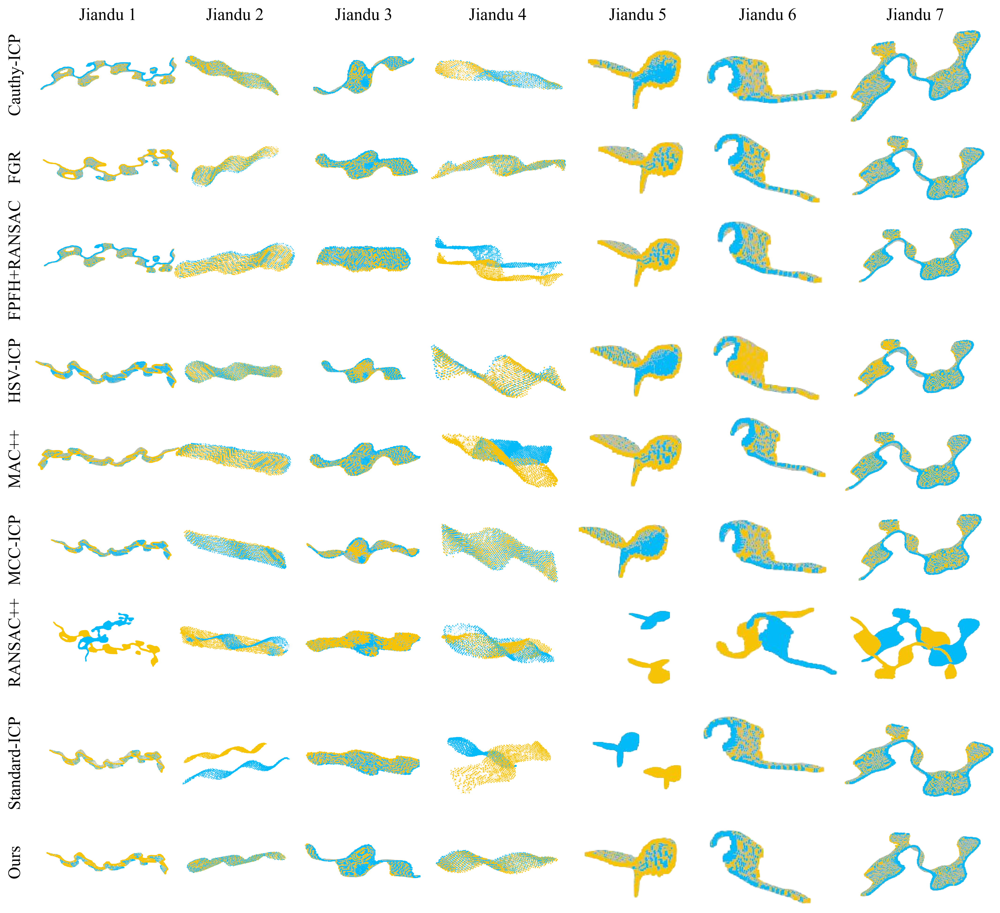

*Fig. 6：合成简牍上的传统方法对比。*

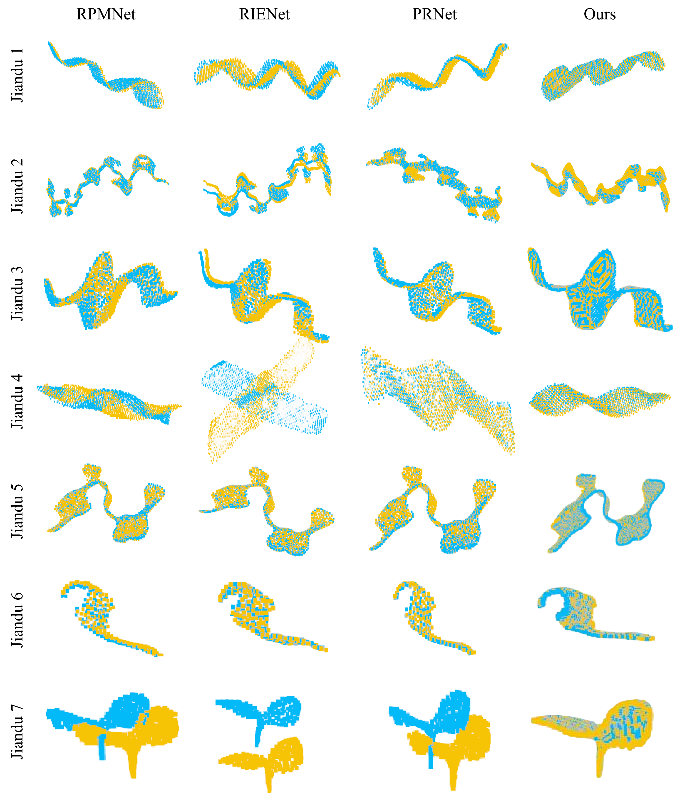

*Fig. 7：合成简牍上的学习方法对比。*

#### 研究背景

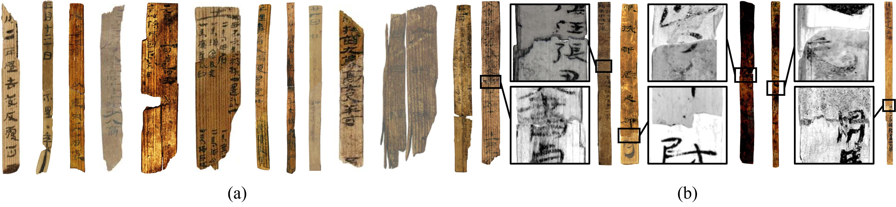

*Fig. 1：简牍样本、墨迹磨损、裂纹与材料缺失等典型退化。*

真实扫描简牍缺少精确位姿真值，几何闭合指标与可视化作为辅助证据，供文保专家进一步评估。

## 项目展示

### 1. 基于深度学习的简牍缀合系统

**校级大学生创新创业项目 · 主持 · 2025.12–2026.12**

围绕三维简牍数据集构建、断裂面配准和碎片虚拟重组开展研究与系统建设。以下动图展示简牍碎片的三维配准过程，保留原始帧序与播放时序。

<table>
<tr><td align="center"><b>三维配准动态展示 I</b></td><td align="center"><b>三维配准动态展示 II</b></td></tr>
<tr>
<td width="50%">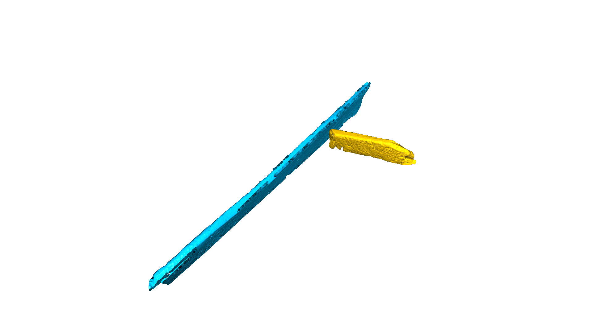</td>
<td width="50%"></td>
</tr>
</table>

[查看动图 I 原文件](animation_2.gif) · [查看动图 II 原文件](animation_4.gif)

软件成果：**基于简牍断裂面的简牍缀合系统**，软件著作权申请中，编号 **2026R11L1818921**（2026）。

### 2. 简牍知识图谱与问答 Agent

**Qwen · Neo4j · Text-to-Cypher · RAG · Backend API**  
项目时间：2024.12–2025.01

- 使用 Qwen 完成简牍文献实体识别、关系抽取与问答推理，构建领域知识图谱。
- 基于 Neo4j 存储关系，实现自然语言到 Cypher 的转换与精准图检索。
- 融合 RAG，面向跨文档、多跳问答与可解释性，完成后端服务封装及 API 开发。

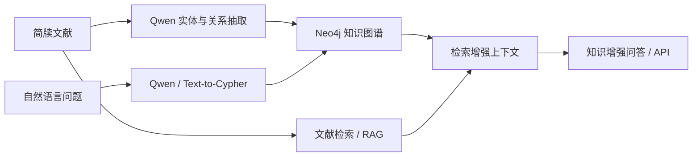

*项目结构示意；不是在线模型演示，也不表示已公开 Agent 实现代码。*

### 3. “数字简牍”信息化平台与文字数据管线

**甘肃省 2023 年度重点人才项目 · 2023010 · 骨干参与 · 2024.02–2026.03**  
[访问数字简牍开放平台](https://jdsjk.nwnu.edu.cn/)

参与平台后端与协同标注流程建设，实现整简图像到单字切片的自动裁剪、背景分离、数据版本管理和质量校验，支撑 OCR 训练、文字检索与知识图谱构建。

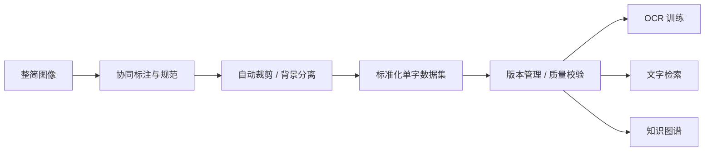

*项目数据流展示；基于已完成工作绘制，非平台运行截图。*

## 学术成果

### 在审论文与研究工作

| 工作 | 研究内容 | 本人署名 / 状态 |
| --- | --- | --- |
| **Less Is More** | Bilateral Coverage-Aware Correspondence Selection for Efficient Point Cloud Registration；双边覆盖感知的对应筛选与高效点云配准 | 第一作者 · 3DV 2027 在审（2026 投稿） |
| **JianduRank** | Fracture-Pretrained Query-Conditioned Reranking for 3D Jiandu Fracture Retrieval；全局 Top-50 召回、断裂预训练、双向交叉注意力和难负样本重排序 | 第一作者 · AI4C在审 |
| **3DJiandu** | A Synthetic and Real-World 3D Dataset for Virtual Reconstruction of Fragmented Jiandu Manuscripts；合成与真实三维简牍数据集 | 第二作者 · Scientific Data 在审，2026 |

JianduRank 稿件报告：来源组互斥测试中，48 个定向查询、每个查询 95 个候选，融合集成达到 **35.42% R@1 / 0.4721 MRR**。检索用于筛出待几何验证的候选，尚不等同于完成刚性配准。

**在审和未确认接收工作的实现代码暂不公开。**

### 其他已接收论文

- **Adaptive Multi-Feature Fusion for Visible-Infrared Image Registration and Character Enhancement of Bamboo Slips.** Teng Wan, Fengchen Qi, **Yanna Yang**, Ying Qi, Qiang Zhang, Shaoyi Du. *npj Heritage Science*, 14, Article 96, 2026；简历标注 Accepted。
- **Reliability-Guided Source-Prior RGB–IR Fusion for Bamboo Manuscript Enhancement.** Jintan Han, Ying Qi, Qiang Zhang, Teng Wan, **Yanna Yang**. *PRCV 2026*（CCF-C），Accepted。
- **Sparse Grassmann Attention for Color-Preserving Infrared–Visible Fusion of Bamboo-Slip Images.** Jintan Han, Ying Qi, Qiang Zhang, Teng Wan, **Yanna Yang**. *ICIG 2026*，Accepted；会议及分类按简历记录。

## 科研项目与实习

| 时间 | 项目 / 角色 | 主要工作 |
| --- | --- | --- |
| 2024.02–2026.03 | **文化遗产智能计算人才队伍培养 + “数字简牍”信息化平台建设**；甘肃省 2023 年度重点人才项目，2023010，骨干参与 | 平台后端；文字数据标注与预处理；多人协同标注流程与规范；整简自动裁剪、单字背景分离；数据版本管理与质量校验，支撑 OCR、文字检索与知识图谱 |
| 2026.01–2030.12 | **基于多阶特征关联的残损西北汉简断裂面配准缀合方法研究**；国家自然科学基金项目，参与 | 参与申请书研究内容、技术路线、实验及可行性分析；三维数据集、断裂面配准、对应筛选与虚拟重组前期研究。项目周期按简历记录 |
| 2025.12–2026.12 | **基于深度学习的简牍缀合系统**；校级大学生创新创业项目，主持 | 科学问题凝练、技术路线与实验方案；三维简牍数据集、断裂面配准与虚拟重组 |
| 2025.09–2026.03 | **中电万维有限公司**，甘肃兰州；云中台实习 | 云中台相关实践 |

**软件成果：** 基于简牍断裂面的简牍缀合系统，软件著作权申请中，编号 **2026R11L1818921**（2026）。

## 教育与技能

- **西北师范大学** · 软件工程硕士 · 2024.09–至今
- **天津理工大学** · 制药工程本科 · 2018.09–2022.06

**3D vision:** 点云预处理、特征匹配、对应筛选、刚性位姿估计、粗到精配准、三维数据集与基准评测；Open3D、3DMatch/3DLoMatch、ModelNet40。  
**Deep learning:** Python、Linux/GPU、模型训练调试、损失设计、消融实验、跨数据集与跨主干验证。  
**Geometry & multimodality:** RANSAC、ICP、SVD、局部几何描述、李群李代数、黎曼/Grassmann 流形学习。  
**English:** CET-4、CET-6，英文文献阅读与英文学术写作。

---
联系： [18822044020@163.com](mailto:18822044020@163.com)。欢迎就三维配准、数字文化遗产与 AI agents 交流。

论文状态依据所提供材料；JianduReg 图组来自原始论文，动图来自本人提供的项目素材。未接收论文的实现代码、模型与训练数据不在本主页公开。
