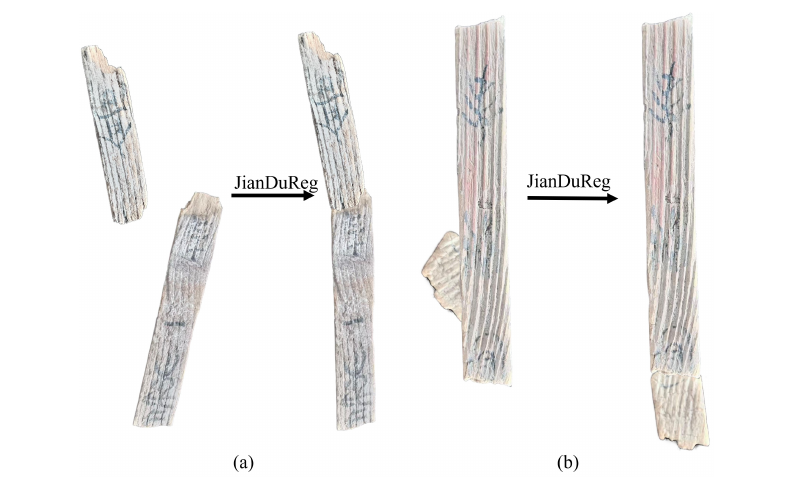
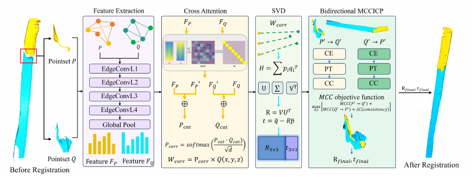
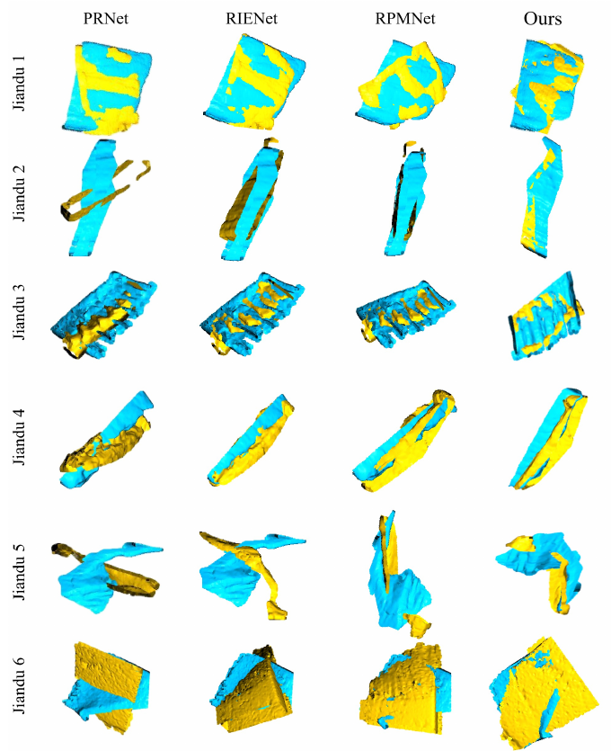
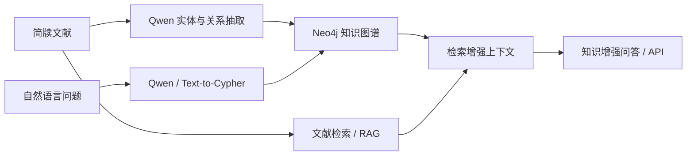

# Hi, I'm Yanna Yang / 杨艳娜

### 3D Point Cloud Registration · Virtual Reassembly · AI Agents

西北师范大学软件工程硕士研究生。我主要研究**三维点云配准、可靠对应筛选、碎片化对象虚拟重建**，同时探索 **Qwen + Neo4j + RAG** 驱动的简牍知识图谱与问答智能体。

**Research interests:** Point cloud registration · Correspondence selection · Fracture retrieval · 3D datasets · Knowledge graphs · AI agents

[Email](mailto:18822044020@163.com) · [JianduReg](https://github.com/yannayang58-dev/JianduReg) · [数字简牍平台](https://jdsjk.nwnu.edu.cn/) · [个人网站](https://yannayang58-dev.github.io/)

## 真实简牍碎片的配准与虚拟缀合

### JianduReg — 从分离碎片到虚拟重组

**A Fracture Surface Guided Multistage Registration Framework for Bamboo Slip Point Clouds**  
Teng Wan, **Yanna Yang**, Fengchen Qi, Qiang Zhang, Ying Qi, Shaoyi Du  
**npj Heritage Science · Accepted, 2026 · 第二作者**  
[公开代码与复现示例](https://github.com/yannayang58-dev/JianduReg)

针对简牍极薄、断裂面狭窄、磨损和缺失引起的配准困难，结合断裂面几何先验、法向增强深度粗配准（NE-DCP）与双向最大相关熵精配准（BMCC-ICP），生成供专家进一步评估的非接触式虚拟缀合结果。

*真实扫描简牍的配准前后对比。来自 JianduReg 论文 Fig. 10；左右为分离碎片与对应的虚拟重组结果。*

<b>查看方法框架与真实断裂面结果对比</b>

*Fig. 2：断裂面提取 → 法向增强特征与交叉注意力 → SVD 粗位姿 → 双向 MCC-ICP 精配准。*

*Fig. 9：真实简牍断裂面上 PRNet、RIENet、RPMNet 与 JianduReg（Ours）的定性对比。青色与黄色表示待配准的两部分，图中保留原论文的方法和样本标注。*

真实简牍数据缺少精确位姿真值；闭合度、间隙等几何指标与可视化是辅助评估证据，不能替代专家判断。

## 配准、检索与数据集研究

| 工作 | 研究内容 | 本人署名 / 状态 |
| --- | --- | --- |
| **Less Is More** | Bilateral Coverage-Aware Correspondence Selection for Efficient Point Cloud Registration；双边覆盖感知的对应筛选与高效点云配准 | 第一作者 · 3DV 2027 在审（2026 投稿） |
| **JianduRank** | Fracture-Pretrained Query-Conditioned Reranking for 3D Jiandu Fracture Retrieval；全局 Top-50 召回、断裂预训练、双向交叉注意力和难负样本重排序 | 第一作者 · 研究稿件，接收/发表状态待确认 |
| **3DJiandu** | A Synthetic and Real-World 3D Dataset for Virtual Reconstruction of Fragmented Jiandu Manuscripts；合成与真实三维简牍数据集 | 第二作者 · Scientific Data 在审，2026 |

JianduRank 稿件报告：来源组互斥测试中，48 个定向查询、每个查询 95 个候选，融合集成达到 **35.42% R@1 / 0.4721 MRR**。检索用于筛出待几何验证的候选，尚不等同于完成刚性配准。

**在审和未确认接收工作的实现代码暂不公开。**

## AI Agents · 简牍知识图谱与智能问答

**Qwen · Neo4j · Text-to-Cypher · RAG · Backend API**  
项目时间：2024.12–2025.01

- 使用 Qwen 完成简牍文献实体识别、关系抽取与问答推理，构建领域知识图谱。
- 基于 Neo4j 存储关系，实现自然语言到 Cypher 的转换与精准图检索。
- 融合 RAG，面向跨文档、多跳问答与可解释性，完成后端服务封装及 API 开发。

*项目结构示意；不是在线模型演示，也不表示已公开 Agent 实现代码。*

## 其他已接收论文

- **Adaptive Multi-Feature Fusion for Visible-Infrared Image Registration and Character Enhancement of Bamboo Slips.** Teng Wan, Fengchen Qi, **Yanna Yang**, Ying Qi, Qiang Zhang, Shaoyi Du. *npj Heritage Science*, 14, Article 96, 2026；简历标注 Accepted。
- **Reliability-Guided Source-Prior RGB–IR Fusion for Bamboo Manuscript Enhancement.** Jintan Han, Ying Qi, Qiang Zhang, Teng Wan, **Yanna Yang**. *PRCV 2026*（CCF-C），Accepted。
- **Sparse Grassmann Attention for Color-Preserving Infrared–Visible Fusion of Bamboo-Slip Images.** Jintan Han, Ying Qi, Qiang Zhang, Teng Wan, **Yanna Yang**. *ICIG 2026*，Accepted；会议及分类按简历记录。

## 项目与实践

| 时间 | 项目 / 角色 | 主要工作 |
| --- | --- | --- |
| 2024.02–2026.03 | **文化遗产智能计算人才队伍培养 + “数字简牍”信息化平台建设**；甘肃省 2023 年度重点人才项目，2023010，骨干参与 | 平台后端；文字数据标注与预处理；多人协同标注流程与规范；整简自动裁剪、单字背景分离；数据版本管理与质量校验，支撑 OCR、文字检索与知识图谱 |
| 2026.01–2030.12 | **基于多阶特征关联的残损西北汉简断裂面配准缀合方法研究**；国家自然科学基金项目，参与 | 参与申请书研究内容、技术路线、实验及可行性分析；三维数据集、断裂面配准、对应筛选与虚拟重组前期研究。项目周期按简历记录 |
| 2025.12–2026.12 | **基于深度学习的简牍缀合系统**；校级大学生创新创业项目，主持 | 科学问题凝练、技术路线与实验方案；三维简牍数据集、断裂面配准与虚拟重组 |
| 2025.09–2026.03 | **中电万维有限公司**，甘肃兰州；云中台实习 | 云中台相关实践 |

**软件成果：**基于简牍断裂面的简牍缀合系统，软件著作权申请中，编号 **2026R11L1818921**（2026）。

## 教育与技能

- **西北师范大学** · 软件工程硕士 · 2024.09–至今
- **天津理工大学** · 制药工程本科 · 2018.09–2022.06

**3D vision:** 点云预处理、特征匹配、对应筛选、刚性位姿估计、粗到精配准、三维数据集与基准评测；Open3D、3DMatch/3DLoMatch、ModelNet40。  
**Deep learning:** Python、Linux/GPU、模型训练调试、损失设计、消融实验、跨数据集与跨主干验证。  
**Geometry & multimodality:** RANSAC、ICP、SVD、局部几何描述、李群李代数、黎曼/Grassmann 流形学习。  
**English:** CET-4、CET-6，英文文献阅读与英文学术写作。

---
欢迎交流 **3D registration、virtual reassembly、digital cultural heritage 与 AI agents**。  
论文状态依据所提供简历；图像取自本人参与的 JianduReg 论文，仅提取排版，不生成或修改实验结果。
